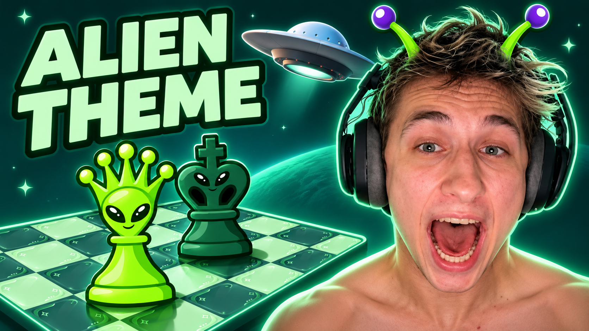

# Install Alien Theme on Chess.com

Alien Theme replaces Chess.com’s Green preset with an alien chessboard and piece set. Choose the edition you want and keep that edition enabled in Tampermonkey.

| Edition | What you get |
| --- | --- |
| [Alien Theme v1.0](./Alien%20Theme%20v1.0.user.js) | The board and pieces, plus animations, space effects, sounds, the victory parade, and four minigames. |
| [Alien Lite](./Alien%20Lite.user.js) | The board and pieces only. |

## Install the script

1. Install [Tampermonkey](https://www.tampermonkey.net/) in your browser.
2. Open the script for your edition using the link above. On GitHub, click **Raw** or **View raw** to open the userscript installer. Click **Install** in Tampermonkey. [Tampermonkey installation guide](https://www.tampermonkey.net/faq.php?q=Q102)
3. If you’re switching editions, open the Tampermonkey dashboard and disable the other Alien script.
4. Refresh Chess.com. Open **Settings → Board & Pieces → Presets**.
5. Select **Alien** for the full edition or **Alien Lite** for the lightweight edition, then click **Save**.
(Tutorial: https://www.youtube.com/watch?v=9KyiWIk3lHc)

## Use the full edition

Click the **Alien** button to change effects, try **Preview win**, or open **Minigames**. Drag the button to move it. Alien Lite is controlled through the Chess.com preset.

## If the theme doesn’t appear

- Check that your chosen edition is enabled in the Tampermonkey dashboard and refresh the Chess.com tab.
- In Chrome, if Tampermonkey asks for permission to run userscripts, open its extension details and enable **Allow User Scripts**. [Tampermonkey permissions guide](https://www.tampermonkey.net/faq.php?q=Q209)
- If clicking **Raw** opens source code, copy the entire script, including the header. In the Tampermonkey dashboard, create a new script, replace the starter code, and save. [Tampermonkey installation guide](https://www.tampermonkey.net/faq.php?q=Q102)
